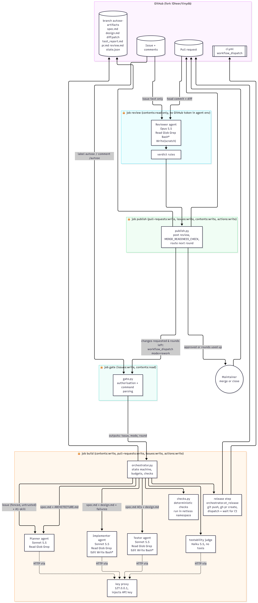

# Component view

The workflow has one deterministic **orchestrator** and four LLM agents. Agents never
call GitHub, never hold a credential and never decide whether a check passed. Each box
with a lock is a separate GitHub Actions job with its own `GITHUB_TOKEN` permissions.

`Bash*` = sandboxed Bash (bubblewrap, no network), restricted by a per-role command
allowlist enforced in a `PreToolUse` hook.

## Components

| Component | Kind | Responsibility | Can write | Talks to GitHub |
|---|---|---|---|---|
| `gate.py` | code | Decide whether an event may start a run (label name, `author_association`), parse `/autose` commands, acknowledge on the issue | issue comment | yes (`gh`, job token) |
| `orchestrator.py` | code | State machine for stages 1–5, retry and round budgets, cost cap, artifact writing, resume after restart | branch `autose/issue-N`, `autose-artifacts` | yes, via its release step and `store.py` only |
| `checks.py` | code | The check for every stage; runs pytest/mypy in a network-less user namespace with a scrubbed environment | nothing | no |
| key proxy | code | Local HTTP proxy that adds the real API key, so no agent process or child process holds it | nothing | no |
| Planner | agent | Stage 1 (spec, using the A1 `requirements-specifier` skill) and stage 2 (design, using `ARCHITECTURE.md`), as two fresh sessions | nothing (returns structured output) | no |
| Implementer | agent | Stage 3: change source files named in `design.md` | files listed in the design, outside `tests/` | no |
| Tester | agent | Stage 4: one test per acceptance criterion in `tests/test_autose_issue_N.py` | that one file | no |
| testability judge | single LLM call | Second opinion for the stage 1 check: is each acceptance criterion testable? | nothing | no |
| release step (`st_release` in `orchestrator.py`) | code | Stage 5: commit, secret scan, push, open/update PR, dispatch CI and wait for it | branch, PR | yes |
| Reviewer | agent | Stage 6: independent review from issue + diff + repository at PR head | a scratch directory outside the repo | no |
| `publish.py` | code | Post the review, enforce verdict rules, write `MERGE_READINESS_CHECK`, start the next round or hand over to the human | PR review/comment, labels | yes |

## Who calls whom

- GitHub events call **gate**; gate's outputs feed **build** (`needs: gate`).
- **build** runs the orchestrator, which calls agents through `agents.py` (Claude Agent
  SDK `query()`), calls `checks.py` after every stage, and runs its release step at stage 5.
- **review** depends on **build** and receives only a PR number and an issue number. It
  checks out the PR head itself, so nothing from the build job's workspace reaches it.
- **publish** depends on **review**, posts the result and, if changes were requested and
  rounds remain, re-enters the workflow with `workflow_dispatch` (the only event a
  `GITHUB_TOKEN` is allowed to trigger).
