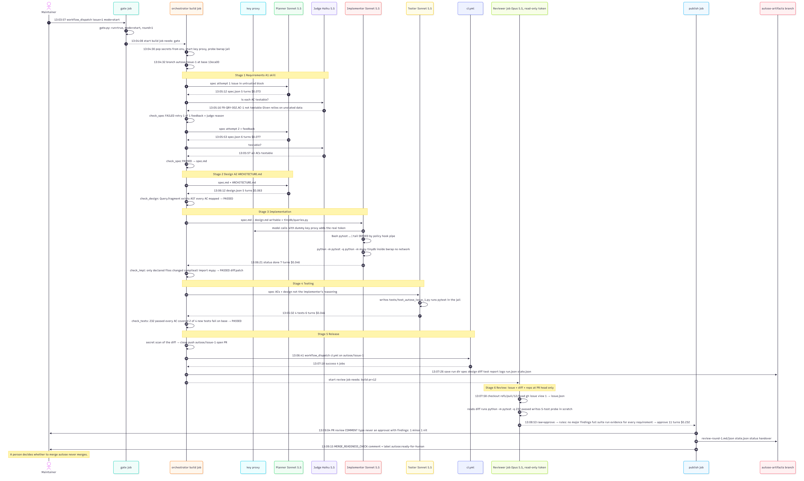

# Sequence view: one real run (issue #1, run 43717026729)

Issue [#1](https://github.com/iDheer/tinydb/issues/1) ("Searching with fragment() on a nested
field returns the results of a different field") went from trigger to `MERGE_READINESS_CHECK`
in **5 minutes 18 seconds** of wall-clock time on 2026-11-15 (all times UTC, from the job logs of
[run 43717026729](https://github.com/iDheer/tinydb/actions/runs/43717026729)). Result: PR
[#12](https://github.com/iDheer/tinydb/pull/12), approved by the reviewer and passing all 3 hidden
tests. The model cost was $0.31 for stages 1–5 and $0.23 for the review.

An earlier attempt on the same issue ([run 43716337981](https://github.com/iDheer/tinydb/actions/runs/43716337981))
stopped at stage 3 because the SDK sandbox could not start on the runner; see [ADR-011](../decisions/ADR-011.md).
This run is the first one after that fix. It was started by `workflow_dispatch` (`issue=1, mode=start`)
because the issue already carried the `autose` label.

## What the run shows

- **A check sent work back.** The testability judge rejected one acceptance criterion whose
  Given relied on data that only the issue mentioned. The deterministic `check_spec` turned that
  into a retry with the judge's reason as feedback, and the second spec passed.
- **The policy hook denied two commands.** The implementer and the tester each tried
  `pytest … | tail`. The hook rejected the pipe, and both agents reran the plain command, which
  then ran inside the bubblewrap jail.
- **The reviewer only saw its allowed inputs.** It checked out `refs/pull/12/head` with a
  read-only token. It ran the full suite itself and wrote its own probe tests. Its
  requirement table cites that evidence.
- **Tokens for stages 1–5:** 40 uncached input, 16,593 output, 254,338 cache-read and 56,702
  cache-write tokens.
